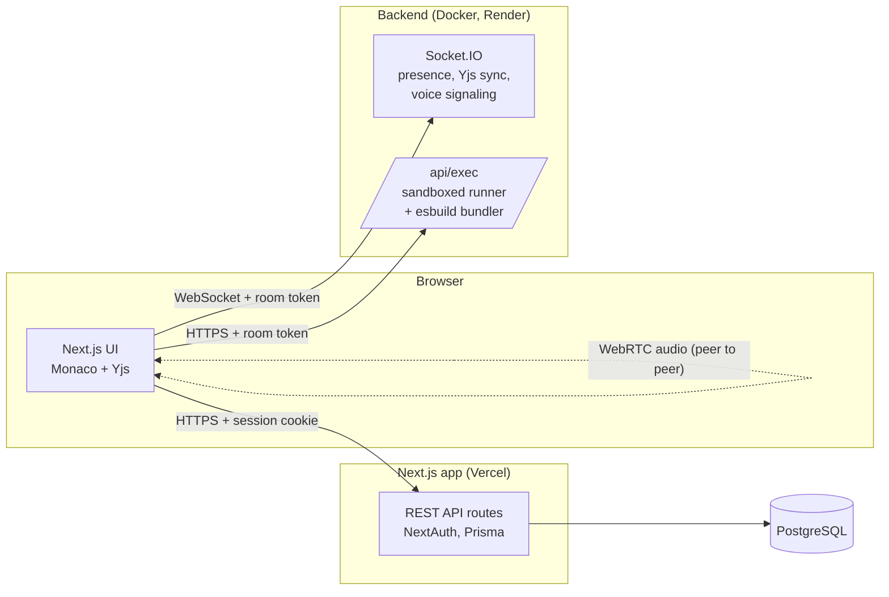

# ArcadeIDE

**A real-time collaborative code editor in the browser.** Several people edit the same files at the same time, see each other's cursors, talk over built-in voice chat, run code in six languages on a sandboxed server, preview web pages live, keep a git-style history and ask an AI assistant for help, all in one shared room.

Built for pair programming, technical interviews and teaching.

## Features

### Collaboration
- **Conflict-free live editing.** Every open file is a [Yjs](https://yjs.dev) CRDT document, so simultaneous typing in the same file merges instead of overwriting.
- **Remote cursors and selections** with each collaborator's name and color.
- **Presence**: who is in the room and whose microphone is live.
- **Voice chat** over peer-to-peer WebRTC (full mesh, "perfect negotiation"), with optional TURN support.
- **Shared terminal**: everyone sees who ran what and the output.
- Per-user undo/redo (undo never reverts someone else's typing), autosave and offline tolerance (edits made during a brief disconnect are merged back).

### Running code
- **JavaScript, TypeScript, Python, C, C++ and Java**, with multi-file projects (imports between files and folders) and program input (stdin).
- Popular npm packages (lodash, dayjs, uuid, date-fns, ramda, moment, validator) are available to Node programs.
- **Live HTML/CSS/JS preview** that rebuilds as anyone types. npm imports such as `import _ from "lodash"` or React work because the backend bundles them with esbuild. Includes a console panel for `console.log` and runtime errors.

### Workspace
- Rooms, teams and email invites with access control on every API route.
- File explorer with nested folders; create, rename and delete sync to everyone.
- Version control: commit selected files, inspect diffs, revert (open editors reload for everyone).
- AI assistant: explain a selection, refactor, add comments, or fix the last runtime error, with a diff to accept or discard.
- Monaco editor (the VS Code editor) with themes and snippets, ZIP export, profiles, email/password plus optional Google/GitHub sign-in.

## Architecture



The system is split in two deployable parts:

| Part | Responsibility | Where |
|---|---|---|
| **Next.js app** (`/`) | Pages, auth, rooms/teams/files/commits API, AI routes | Vercel or Netlify (serverless) |
| **Backend** (`/server`) | WebSockets (presence, document sync, cursors, voice signaling, file events, terminal) and code execution | Any Docker host with long-lived processes (Render, Railway, Fly.io, a VPS) |

Serverless platforms cannot keep WebSocket connections open or run compilers, which is why the backend is a separate service.

### Key design decisions

- **Room tokens instead of shared sessions.** The backend has no database access. When a user opens a room, the Next.js app checks that they are the owner, an invited member or a team member, then signs a short-lived JWT (`HS256`, 2 hours) containing the room and user. The backend verifies it with a shared secret for every socket connection and every run. Users can only join rooms they have access to, and the backend stays stateless and simple to deploy.
- **CRDTs for editing.** Sending whole files on every keystroke loses edits when two people type at once. Yjs merges concurrent operations deterministically. The server keeps one in-memory document per open file; the first editor seeds it from the database and later editors receive the live state. A document id lets reconnecting clients know whether merging their offline edits is safe. Persistence stays in the REST API.
- **Defense-in-depth sandbox.** Each run gets a temporary directory and runs as an unprivileged Linux user with `prlimit` limits on CPU time, memory, processes (fork bombs), file size and open files. It also has a wall-clock timeout that kills the whole process group, output caps, a concurrency queue and per-user rate limits. `tini` reaps orphaned processes. Static checks reject obvious process-spawning and networking APIs. The runner never sees the server's secrets.
- **Isolated preview.** The preview iframe has no `allow-same-origin`, so code from one collaborator can never act on another user's session.

## Tech stack

| Layer | Technology |
|---|---|
| Frontend | Next.js 16 (App Router), React 19, TypeScript, Tailwind CSS 4, Monaco Editor, Motion |
| Collaboration | Yjs (CRDT), Socket.IO, WebRTC |
| Backend | Node.js, Express 5, Socket.IO, esbuild, jose (JWT) |
| Data & auth | PostgreSQL, Prisma ORM, NextAuth (credentials, Google, GitHub) |
| AI | OpenAI API (or any OpenAI-compatible provider) |
| DevOps | Docker, docker-compose, GitHub Actions, Vercel, Render |
| Testing | Jest, Node test runner, API end-to-end script, Playwright browser tests |

## Getting started

### Option A: everything in Docker

Requires Docker Desktop.

```bash
git clone https://github.com/xaemonn/ArcadeIDE.git
cd ArcadeIDE
docker compose up --build
```

Open http://localhost:3000 and sign up. This starts PostgreSQL, applies migrations and runs the backend and the app. If port 5433 is busy, run `POSTGRES_PORT=5434 docker compose up --build`. Optional keys (OpenAI, OAuth) are read from `.env` if present.

### Option B: development mode

Requires Node.js 20.11+ and a PostgreSQL database (`docker compose up -d db` works).

```bash
npm install
cp .env.example .env               # set DATABASE_URL, NEXTAUTH_SECRET, ...
npx prisma migrate dev

cd server && npm install && cp .env.example .env && cd ..
npm run server:dev                 # backend on http://localhost:4000
npm run dev                        # app on http://localhost:3000
```

In development the backend runs code directly on your machine without sandboxing, using whatever compilers are installed. Use the Docker image for anything public.

## Environment variables

**Next.js app** (`.env`, see [.env.example](.env.example))

| Variable | Required | Description |
|---|---|---|
| `DATABASE_URL` | yes | PostgreSQL connection string |
| `NEXTAUTH_URL` | yes | Public URL of the app |
| `NEXTAUTH_SECRET` | yes | Session encryption secret (`openssl rand -base64 32`) |
| `NEXT_PUBLIC_BACKEND_URL` | yes | Public URL of the backend (inlined at build time) |
| `ROOM_TOKEN_SECRET` | yes | Shared with the backend; must be identical |
| `GOOGLE_CLIENT_ID` / `GOOGLE_CLIENT_SECRET` | no | Enables Google sign-in |
| `GITHUB_CLIENT_ID` / `GITHUB_CLIENT_SECRET` | no | Enables GitHub sign-in |
| `OPENAI_API_KEY` | no | Enables the AI assistant |
| `OPENAI_BASE_URL`, `OPENAI_MODEL` | no | Use another OpenAI-compatible provider/model |
| `NEXT_PUBLIC_CLOUDINARY_CLOUD_NAME` / `_UPLOAD_PRESET` | no | Profile picture uploads |
| `NEXT_PUBLIC_TURN_URL` / `_USERNAME` / `_CREDENTIAL` | no | TURN server for voice behind strict firewalls |

**Backend** (`server/.env`, see [server/.env.example](server/.env.example))

| Variable | Required | Description |
|---|---|---|
| `ROOM_TOKEN_SECRET` | yes | Same value as in the app |
| `CLIENT_ORIGIN` | yes | Allowed app origin(s), comma separated; `*` wildcards one DNS label |
| `PORT` | no | Defaults to 4000 |
| `EXEC_CONCURRENCY`, `EXEC_TIMEOUT_MS`, `EXEC_RATE_LIMIT_PER_MINUTE`, ... | no | Runner limits |

## Deployment (free tiers)

1. **Database: [Neon](https://neon.tech) or [Supabase](https://supabase.com).** Create a project and copy the PostgreSQL connection string.
2. **Backend: [Render](https://render.com).** New → Blueprint → select this repository; it reads [`render.yaml`](render.yaml). Set `ROOM_TOKEN_SECRET` (a long random string) and `CLIENT_ORIGIN` (your frontend URL, filled in after step 3). Check `https://<backend>/health`: it should report `"sandbox": {"mode": "isolated"}` and every language as `true`.
3. **Frontend: [Vercel](https://vercel.com).** Import the repository and add the app variables above, with `NEXT_PUBLIC_BACKEND_URL` set to the Render URL and the same `ROOM_TOKEN_SECRET`. Vercel runs the `vercel-build` script, which applies database migrations before building.
4. Update `CLIENT_ORIGIN` on Render with the final Vercel URL, and `NEXTAUTH_URL` on Vercel.
5. (Optional) OAuth callback URLs: `https://<app>/api/auth/callback/google` and `https://<app>/api/auth/callback/github`.

**Netlify** works for the frontend too. Its build runs `npm run build`, which does not migrate, so run `npx prisma migrate deploy` against the database once (and after schema changes).

**Free-tier notes.** Render's free plan sleeps after 15 minutes without traffic and needs about a minute to wake up. Open the app a few minutes before a demo (or use the paid starter plan). The editor keeps working offline meanwhile and reconnects on its own.

## Testing

```bash
npm test                         # unit tests (Jest)
npm run lint
cd server && npm test            # backend integration tests: sockets, CRDT sync, voice signaling, runner, bundler
npm run test:e2e                 # API + realtime end-to-end against a running stack (creates throwaway users)
npm run test:ui                  # two real browser sessions: co-editing, run, voice, preview (uses installed Chrome)
cd server && ROOM_TOKEN_SECRET=... npm run smoke -- https://<backend>   # checks a deployed backend
```

CI ([.github/workflows/ci.yml](.github/workflows/ci.yml)) lints, tests and builds both parts on every push.

## Limitations

- The backend keeps realtime state in memory, so it runs as a single instance. Scaling out would need the Socket.IO Redis adapter and shared Yjs persistence.
- The code sandbox relies on an unprivileged user and resource limits. Networking from user code is blocked by static checks, and by a network namespace only where the host allows unprivileged user namespaces. For untrusted public traffic, run the runner under gVisor or nsjail, or use a hosted judge.
- The editor is desktop-only; small screens see a notice.

## Roadmap

- Push commits to GitHub and import repositories
- Video calls alongside voice chat
- More runtimes (Go, Rust, Ruby)
- Inline code comments and @mentions
- Mobile and tablet layout

## 👤 Author

**Dishakwatra**
- GitHub: [@xaemonn](https://github.com/xaemonn)
- Repository: [https://github.com/xaemonn/ArcadeIDE](https://github.com/xaemonn/ArcadeIDE)

## 📄 License

This project is licensed under the MIT License - see the [LICENSE](LICENSE) file for details.

